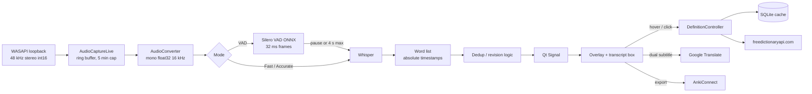

# PROJECT_CONTEXT.md — Subtitles-to-Anki

Full context and data reference for any AI (or human) joining this project: what it is, why it exists, how data flows through it, what every data structure looks like, and what is currently broken. Written 2026-10-12.

Companion file: [AGENTS.md](AGENTS.md) holds the short working rules for coding agents (conventions, Qt gotchas, how to run). This file holds the background and the data.

Anything marked **CONFIRMED** was reproduced. Anything marked **SUSPECTED** comes from reading code and was not reproduced. Anything marked **UNVERIFIED** has never been tested.

---

## 1. Purpose

A Windows desktop app for language learners watching foreign-language video (the target scenario is a full-length Netflix film).

1. Captures whatever audio the PC is playing (WASAPI loopback, no microphone needed).
2. Transcribes it live with Whisper.
3. Shows the words as clickable subtitles in a borderless always-on-top overlay.
4. Hover a word: quick definition card. Click a word: full detail window (pronunciation, meanings, forms, examples).
5. One click exports the word as a flashcard to Anki through the AnkiConnect add-on.
6. Optional second subtitle line with an English translation.

The owner is a learner building this for personal use, with a plan to publish it on GitHub, so strangers must be able to install and run it easily.

## 2. Owner priorities (in order)

1. Clean MVC + OOP architecture that a stranger can debug without help.
2. Lightweight install: no multi-GB dependencies, low RAM and disk use.
3. Must run for hours (a whole film) without overheating, lag buildup or stutter.
4. Modern, friendly Windows 11 style GUI; the original Tkinter UI was rejected as ugly.
5. Strong logging and error handling, because the project will grow for months.

## 3. Environment

| Item | Value |
|---|---|
| OS | Windows only (WASAPI loopback, PyAudioWPatch, DWM Mica, registry theme detection). Developed on Windows 11 build 26200. |
| Python | 3.12.10 in `.venv` at the repo root |
| GPU | Optional. Dev machine has 1 CUDA device (an RTX 4070 per an earlier requirements note). CPU fallback is automatic. |
| Run command | `cd App` then `..\.venv\Scripts\python.exe main.py` (imports are relative to `App/`) |
| Shell | PowerShell. Do not chain commands with `&&`. |
| Network | Needed at runtime for definitions, translation, first-run model downloads, and Anki (localhost only). |

## 4. Glossary

| Term | Meaning |
|---|---|
| Loopback | Capturing the audio the PC is *playing* instead of microphone input |
| WASAPI | Windows audio API that provides loopback capture |
| Whisper | OpenAI speech-to-text model, run here through `faster-whisper` |
| ctranslate2 | Inference engine under faster-whisper; owns GPU/CUDA use |
| Silero VAD | Tiny (~2 MB) voice-activity-detection model; says whether a 32 ms audio frame contains speech |
| VAD mode | Transcribe only after a speech pause; lowest resource use; the default |
| Fast / Accurate mode | Re-transcribe a sliding audio window every 0.3 s / 0.7 s regardless of speech; heavy |
| Provisional / confirmed word | Confidence state of a word in the sliding-window modes (see `Word`) |
| Overlay | The borderless always-on-top subtitle bar |
| Hover card / detail dialog | Small definition popup / full word-detail window |
| AnkiConnect | Anki add-on exposing an HTTP API on `localhost:8765` |
| QSS | Qt Style Sheets, a CSS-like language, all kept in `views/theme.py` |
| Mica | Windows 11 frosted-glass window backdrop |

## 5. End-to-end data flow



Stage details:

| Stage | Where | Data in, data out |
|---|---|---|
| Capture | `services/audio_capture_live.py` | Reads 1024-frame chunks (`bytes`, int16, 2 ch, 48 kHz) into `self.frames: list[bytes]`, capped at 300 s |
| Convert | `services/audio_conversion.py` | Joins chunks, stereo to mono (mean), int16 to float32 in [-1, 1], linear-interpolation resample to 16 kHz |
| VAD | `services/vad_service.py` | 512-sample frame to speech probability (0..1), LSTM state kept between frames |
| Segmenting | `services/vad_transcriber.py` | Probability stream to "segment_end" or "max_speech" events |
| Transcribe | `services/whisper_service.py` | float32 array to `list[Word]` with relative timestamps |
| Timestamps | `models/word.py::shift_timestamps` | Window-relative times to absolute session time |
| Dedup | transcribers | Drops words already emitted (time grace and text/time proximity) |
| Deliver | `controllers/transcription_controller.py` | Background thread calls `on_words_callback(words)` |
| Marshal | `views/main_window.py` | `_words_ready` Qt Signal moves data to the GUI thread |
| Render | `views/subtitle_overlay.py` | Last 10 words shown; transcript box capped at 20,000 chars |

Whisper call settings (`whisper_service.py`): `beam_size=5`, `best_of=2`, `vad_filter=True`, `word_timestamps=True`, `condition_on_previous_text=False`, `no_speech_threshold=0.6`. Device: `cuda`/`float16` when GPU is on, otherwise `cpu`/`int8`. `use_gpu=None` means auto-detect with `ctranslate2.get_cuda_device_count()`.

## 6. Data structures

### 6.1 `Word` (`models/word.py`)

| Field | Type | Meaning |
|---|---|---|
| `text` | str | Word text, stripped |
| `startTime`, `endTime` | float | Seconds. Note: camelCase, which breaks the snake_case convention (known debt). |
| `confidence` | float or None | Whisper per-word probability |
| `avg_logprob` | float or None | Segment-level average log-probability |
| `no_speech_prob` | float or None | Segment-level no-speech probability |
| `state` | str | `provisional`, `confirmed` or `revised` (`WordState`) |
| `id` | int | Unique per process (class counter) |
| `simple_result` | dict or None | Filled lazily by `fetch_definition` |
| `detail_result` | dict or None | Filled lazily by `fetch_details` |

Initial state is `confirmed` if `avg_logprob >= -0.40` or `confidence >= 0.65`, else `provisional`. Convenience properties: `definition`, `grammar`, `details`, `is_definition_loaded`, `is_provisional`, `is_confirmed`, `is_revised`. Mutators: `confirm()`, `mark_revised()`.

### 6.2 `TranscriptionConfig` (`models/config.py`)

`model_size: str = "tiny"`, `device_id: int = 10`, `use_gpu: bool = False`, `language: str = "en"`. The GUI overrides these (default model `small`, GPU checkbox on).

### 6.3 Definition results (plain dicts)

`fetch_definition` (hover card):
```json
{"word": "casa", "source_lang": "es", "target_lang": "en",
 "definition": "house", "grammar": "noun", "error": null}
```
On failure, `definition` and `grammar` are empty strings and `error` holds the message. If a definition is an inflection ("plural of X"), the base word is followed and the text becomes `"<definition>\n\nMeaning (<base>): <base definition>"`.

`fetch_details` (detail dialog):
```json
{"word": "...", "source_lang": "...", "target_lang": "...",
 "details": {
   "partOfSpeech": "noun",
   "senses": [{"definition": "...", "tags": [], "examples": [], "synonyms": [], "antonyms": []}],
   "forms": [{"word": "...", "tags": ["plural"]}],
   "pronunciations": [{"text": "/.../", "tags": ["US"]}]
 },
 "error": null}
```
`details` is the raw first entry from freedictionaryapi.com, so extra keys may exist. Display filtering lives in `definition_service.py` (`SKIP_TAGS`, `BAD_FORM_TAGS`, `GOOD_FORM_TAGS`, `pick_pronunciations`, `pick_forms`, `is_inflection_definition`).

### 6.4 Anki note (`services/anki_note_template.py`, `anki_service.py::build_note_fields`)

Note type name: `Subtitles to Anki` (created automatically if missing). Fields:

| Field | Filled with |
|---|---|
| `Word` | The clicked word |
| `Meaning` | Simple definition plus up to 3 more senses, joined by ` | ` |
| `Grammar` | Part of speech, first pronunciation, up to 4 forms, joined by ` · ` |
| `Example` | First example sentence found in any sense |
| `Example Translation` | Always empty today |
| `Register` | Part of speech |

Duplicates are rejected (`allowDuplicate: false`, scope `deck`). Card HTML/CSS lives in `AnkiNoteTemplate` (`CSS`, `FRONT`, `BACK`).

### 6.5 Reference data (`models/reference_data.py`)

Languages: English `en`, German `de`, French `fr`, Portuguese `pt`, Spanish `es`, Italian `it`, Dutch `nl`, Polish `pl`, Turkish `tr`, Russian `ru`, Japanese `ja`, Korean `ko`, Chinese `zh`.

Whisper models offered (VRAM / RAM figures are the app's own estimates, not measured): `tiny` (~1 GB / ~150 MB), `base` (~1 GB / ~300 MB), `small` (~2 GB / ~500 MB), `medium` (~5 GB / ~1.5 GB), `large-v2` (~10 GB / ~3 GB), `large-v3` (~10 GB / ~3 GB), `turbo` (~6 GB / ~1.5 GB).

## 7. Persistent storage

| Location | Contents | Notes |
|---|---|---|
| `word_cache.db` (repo root, SQLite, WAL mode) | Definition and translation cache | Singleton `CacheService`, thread-safe with a lock |
| `logs/app.log` | Rotating log, 5 MB x 5 files | Includes uncaught exceptions and forwarded Qt warnings |
| `logs/faulthandler.log` | Native crash stacks | Only written on a hard crash |
| `~/.cache/silero_vad/silero_vad.onnx` | Silero VAD weights | Downloaded on first run |
| Hugging Face cache | faster-whisper model files | Downloaded on first model load of each size |
| `live.wav` | Optional recording of the last 5 minutes | Written only when "Save recording to WAV" is on and Stop is pressed |

SQLite schema:
```sql
CREATE TABLE definitions (
  word TEXT NOT NULL, lang TEXT NOT NULL,
  simple TEXT, detail TEXT,            -- JSON strings
  PRIMARY KEY (word, lang));           -- word stored lower-cased
CREATE TABLE translations (
  text TEXT NOT NULL, source_lang TEXT NOT NULL, target_lang TEXT NOT NULL,
  result TEXT NOT NULL,
  PRIMARY KEY (text, source_lang, target_lang));
```

Git-ignored: `.venv/`, `__pycache__/`, `*.wav`, `outputs/*.wav`, `logs/`, `*.log`. Note that `word_cache.db*` is not ignored.

## 8. External services

| Service | Endpoint | Used for | Failure behavior |
|---|---|---|---|
| Free Dictionary API | `https://freedictionaryapi.com/api/v1/entries/{lang}/{word}` | Definitions; 404 retries lower-cased | Result dict with `error`; shown in the card |
| Google Translate (via `deep-translator`) | n/a | Dual-subtitle English line; debounced 0.6 s; target is always `en` | Logged, no subtitle line update |
| AnkiConnect | `http://localhost:8765`, API version 6 | Deck list, create deck, create note type, add note | Dialog shows "Could not start Anki" |
| Anki launcher | Searches `%LOCALAPPDATA%\Programs\Anki`, `C:\Program Files\Anki`, `C:\Program Files (x86)\Anki` for `anki.exe` | Auto-start Anki (waits up to 15 s) | Returns not-ready |
| GitHub raw | `snakers4/silero-vad/.../silero_vad.onnx` (master branch) | First-run VAD download | Raises with a clear message |
| Hugging Face | faster-whisper model repos | First-run model download | Model load fails with the error shown in the status line |

No API keys or secrets are used anywhere.

## 9. Tuning constants

| Constant | Value | File | Effect |
|---|---|---|---|
| `MAX_BUFFER_SECONDS` | 300 | `audio_capture_live.py` | RAM cap for captured audio |
| `SPEECH_THRESHOLD` | 0.5 | `vad_transcriber.py` | Probability counted as speech |
| `PAUSE_FRAMES` | 10 (about 320 ms) | `vad_transcriber.py` | Silence that ends a segment |
| `MIN_SEGMENT_SEC` | 0.15 | `vad_transcriber.py` | Shorter segments ignored |
| `MAX_SPEECH_SEC` | 4.0 | `vad_transcriber.py` | Forces a transcription mid-speech |
| `CONTEXT_SEC` / `OVERLAP_SEC` / `FLUSH_CUTOFF_SEC` | 0.5 / 0.8 / 0.4 | `vad_transcriber.py` | Audio context and forced-flush handling |
| Tick interval and window | VAD 0.05 s; Fast 0.3 s with 2.0 s window; Accurate 0.7 s with 3.5 s window | `transcription_controller.py` | How often Whisper runs |
| `MIN_WORD_PROB`, `MAX_NO_SPEECH_PROB`, `REVISION_WINDOW_SEC`, `MIN_OVERLAP_RATIO`, `NGRAM_N` | 0.55, 0.70, 2.5, 0.6, 2 | `live_transcriber.py` | Sliding-window filtering and revision |
| `MAX_SUBTITLE_WORDS` | 10 | `main_window.py` | Words shown on the overlay |
| `MAX_TRANSCRIPT_CHARS` | 20,000 | `main_window.py` | Transcript box cap |
| `MAX_SENSES` | 4 | `subtitle_overlay.py` | Senses shown in the detail dialog |

## 10. Module map

| Path | Responsibility | Implements |
|---|---|---|
| `App/main.py` | Entry point: logging, `QApplication`, Fusion style, theme, window | n/a |
| `App/models/` | `word.py`, `config.py`, `reference_data.py` | n/a |
| `App/interfaces/` | One ABC per service boundary | `ITranscriptionEngine`, `IAudioRecorder`, `IVoiceActivityDetector`, `IAnkiGateway`, `IDefinitionProvider`, `ITranslationProvider`, `ICacheRepository` |
| `App/services/whisper_service.py` | Speech-to-text | `ITranscriptionEngine` |
| `App/services/audio_capture_live.py` | Loopback capture and buffer | `IAudioRecorder` |
| `App/services/vad_service.py` | Silero VAD on ONNX Runtime | `IVoiceActivityDetector` |
| `App/services/live_transcriber.py` | Fast/Accurate sliding-window transcriber | n/a |
| `App/services/vad_transcriber.py` | Pause-gated transcriber | n/a |
| `App/services/definition_service.py` | Dictionary lookups plus display helpers | `IDefinitionProvider` via `DefinitionService` |
| `App/services/translation_service.py` | Debounced Google translation | `ITranslationProvider` |
| `App/services/cache_service.py` | SQLite cache | `ICacheRepository` |
| `App/services/anki_service.py`, `anki_note_template.py` | AnkiConnect client and card design | `IAnkiGateway` via `AnkiService` |
| `App/services/audio_device_service.py` | Lists WASAPI loopback devices | n/a |
| `App/services/audio_conversion.py` | PCM to Whisper-ready array | n/a |
| `App/controllers/app_controller.py` | Facade used by all views | n/a |
| `App/controllers/transcription_controller.py` | Model lifecycle, capture and transcription threads | n/a |
| `App/controllers/definition_controller.py`, `anki_controller.py`, `translation_controller.py` | Background-thread wrappers over services | n/a |
| `App/views/main_window.py` | Control window | n/a |
| `App/views/subtitle_overlay.py` | Overlay, hover card, detail dialog | n/a |
| `App/views/deck_picker.py` | Anki deck picker dialog | n/a |
| `App/views/theme.py` | Palette, fonts, QSS, system light/dark detection | n/a |
| `App/views/native_effects.py` | Mica backdrop and dark title bar via DWM | n/a |
| `App/utils/app_logger.py`, `text_utils.py` | Logging setup; punctuation stripping | n/a |

Public `AppController` API (views must use only this): `load_transcription(config)`, `unload_transcription()`, `is_transcription_loaded`, `is_recording`, `set_translate(bool)`, `start_live_background(on_words_callback, mode)`, `start_overlapping_chunked_background(...)` (legacy), `stop_live_background(save_wav)`, `is_dual_subtitle_enabled`, `set_dual_subtitle(bool)`, `translate_subtitle(text, source_lang, callback)`, `fetch_hover_definition(...)`, `fetch_full_definition(...)`, `ensure_anki_ready(...)`, `create_anki_deck(...)`, `save_to_anki(...)`.

## 11. Threading model

- GUI thread: all widgets.
- Audio capture thread: loops on `read_chunk()` with a 1 ms sleep.
- Transcription thread: loops on `tick()` at the mode's interval.
- Short-lived daemon threads: one per definition, Anki or translation request.
- Rule: background threads never touch widgets. They emit Qt `Signal`s and slots run on the GUI thread (`_words_ready`, `definition_ready`, `details_ready`, `_decks_loaded`, `_deck_created`, `_save_finished`, and the overlay's word and translation signals).

## 12. Dependencies (`requirements.txt`)

| Package | Why |
|---|---|
| `faster-whisper==1.2.1`, `ctranslate2==4.6.3`, `tokenizers==0.22.2` | Transcription and GPU support |
| `PySide6==6.11.2` | GUI |
| `onnxruntime==1.23.2` | Silero VAD (CPU) |
| `PyAudioWPatch==0.2.12.8` | WASAPI loopback capture |
| `numpy==2.4.1` | Audio math |
| `requests`, `httpx==0.28.1`, `certifi==2026.1.4` | HTTP (`requests` is unpinned) |
| `deep-translator==1.11.4` | Dual-subtitle translation |
| `psutil==7.2.2` | Optional RAM readout in the GUI |
| `tqdm==4.67.1` | Misc |

Removed on purpose: `torch`, `torchaudio`, `torchvision` (multi-GB, were only needed for Silero and CUDA checks) and `huggingface_hub` as a direct pin. Do not reintroduce torch. GPU use needs an NVIDIA driver plus CUDA runtime libraries already present on the machine.

## 13. Known bugs and technical debt

### Critical

1. **CONFIRMED: transcription stalls once the 5-minute audio buffer fills.**
   Reproduced with a fake stream and a 100-chunk cap: the VAD clock advanced to 2.11 s and then froze while chunks kept arriving. Cause: `AudioCaptureLive.read_chunk` trims `self.frames` to a fixed length, and the transcribers use `len(self.recorder.frames)` both as the read cursor (`VadTranscriber._run_vad`) and as the session clock (`VadTranscriber._abs_now`, `LiveTranscriber.tick`). After the cap, the length stops growing, so the default VAD mode stops seeing new audio and absolute timestamps stop advancing. This directly blocks the whole-film goal.
   Fix direction: keep a monotonic `total_chunks` counter in `AudioCaptureLive`, derive time and cursors from it, and use a `collections.deque(maxlen=...)` instead of re-slicing the list.
   Status: not fixed.

### Suspected or unexplained

2. **UNEXPLAINED crash.** The app exited with code 1 and no Python traceback after two normal load/start/stop cycles. Probably a native-level fault. `faulthandler` now writes to `logs/faulthandler.log`. Read that first if it recurs.
3. **UNVERIFIED: heat and lag over a full film.** Never measured. Fast/Accurate modes re-run Whisper constantly and are inherently heavy.

### Smaller debt

- `Word.startTime` and `endTime` are camelCase; everything else is snake_case.
- `read_chunk` re-slices a ~14,000-item list on every chunk once capped (wasteful copy).
- Model load runs synchronously on the GUI thread, so the window freezes while loading.
- Definitions cache key is `(word, lang)` and ignores the target language.
- Silero model is downloaded from the GitHub `master` branch with no pinned version or checksum.
- `LiveTranscriber` accepts a `vad` argument it never uses; `start_overlapping_chunked_background` is a legacy alias.
- `device_id` default `10` is hard-coded in two places.
- The overlay is fixed near the top of the primary screen (y=60) and is not click-through.
- No automated tests exist; all verification so far was manual smoke scripts and `get_errors`.
- `README.md` and `VAD_INTEGRATION.md` describe the early prototype (torch-based VAD) and are outdated. GitHub setup instructions still need to be written.
- Unreviewed files in the repo root: `.claude/`, `live.wav`, a personal `.wav`, `word_cache.db*`. Do not delete without asking.

## 14. Decision history (why things are the way they are)

| Decision | Reason |
|---|---|
| Removed torch | Only Silero VAD and three CUDA checks used it; multi-GB install against the lightweight goal |
| Silero on ONNX Runtime | Same model and results, a few MB runtime, CPU-only is enough (under 1 ms per frame) |
| GPU stays via `ctranslate2` | Whisper inference never needed torch |
| VAD mode is the default | Whisper runs only after pauses, so it is the only mode plausible for multi-hour use |
| Tkinter to PySide6 | Needed a modern look, QSS stylesheets, GPU-composited rendering; CustomTkinter was the low-risk alternative; web views (Electron or pywebview) were rejected for RAM cost |
| Fusion Qt style | The native Windows style ignores most QSS, so buttons looked inert |
| System light/dark detection plus Mica | Owner asked for Windows 11 style, following the system theme |
| First theme (purple/blue, near-black) rejected | Owner found it ugly; replaced by lighter grey with a vibrant blue accent (`#2f8ef4`) |
| Controllers behind a facade | Old 291-line `AppController` did everything; views keep one stable entry point |
| Views never import services for behavior | Keeps MVC boundaries; display helpers like `pick_forms` are the tolerated exception |
| Transcript box capped | Unbounded growth slowed the UI over long sessions |

## 15. Roadmap

Immediate (blocks the main goal):
1. Fix the buffer-cap stall (section 13, item 1), then test a 30+ minute run in VAD mode.
2. Measure CPU, GPU, RAM and temperature over a long session.

Next:
3. Rewrite `README.md` with accurate install and run steps; update or delete `VAD_INTEGRATION.md`.
4. Add automated tests (word dedup and revision logic, `AudioConverter`, `VadTranscriber` state machine with a fake recorder, cache service).
5. Move model loading off the GUI thread.

Backlog (owner called these nit-picky): adjustable subtitle font size, optional drop shadow, opacity slider, independent controls for the translation line, re-check hover-card formatting.

## 16. Debugging playbook

1. App exits with no message: read `logs/faulthandler.log`, then the end of `logs/app.log`.
2. Python exceptions in background threads and slots land in `logs/app.log` with full tracebacks (`threading.excepthook` and `sys.excepthook` are installed). Qt warnings are forwarded there too, prefixed `[Qt]`.
3. Subtitles stop appearing after roughly 5 minutes: see known bug 1.
4. Buttons or fonts look wrong: check the Qt gotchas in [AGENTS.md](AGENTS.md) (Fusion style, `font_css`, no blanket `QWidget` background, no 8-digit hex).
5. No audio devices listed: the system needs a WASAPI loopback device; use the refresh button after changing audio hardware.
6. Anki export fails: Anki must be installed with the AnkiConnect add-on; the app tries to launch `anki.exe` from the three standard paths.
7. Verify changes with `get_errors`, a smoke script, or by launching the app. State plainly what was and was not verified.

## 17. Working with the owner

- Wants direct, concise answers and honest status, not claims of success without verification.
- Reviews the GUI visually and gives specific feedback; act on it and re-launch the app.
- Confirm before deleting files, renaming modules, or adding heavy dependencies; small reversible edits are fine.
- Do not rush GUI work.
- Do not create extra markdown files unless asked.
